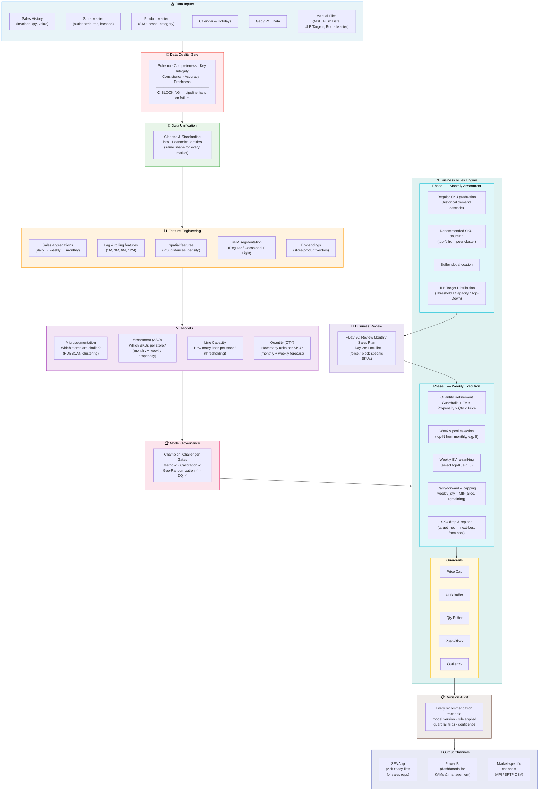

# Mondelez Suggested Orders 2.0 — Product Design

> **Version:** 1.2 · **Date:** 28 May 2026 · **Status:** Draft
> **Owner:** Lingaro Group · **Client:** Mondelez International
> **Audience:** Business stakeholders, Design Authority, program leadership, market onboarding teams

---

## Table of Contents

1. [Executive Summary](#1-executive-summary)
2. [Problem Statement](#2-problem-statement)
3. [Target Users & Stakeholders](#3-target-users--stakeholders)
4. [Solution Overview](#4-solution-overview)
5. [Product Features](#5-product-features)
   - 5.1 [Outlet Microsegmentation](#51-outlet-microsegmentation)
   - 5.2 [Assortment Prediction (ASO)](#52-assortment-prediction-aso)
   - 5.3 [Line Capacity (Thresholding)](#53-line-capacity-thresholding)
   - 5.4 [Assortment Selection](#54-assortment-selection)
   - 5.5 [Quantity Prediction (QTY)](#55-quantity-prediction-qty)
   - 5.6 [Quantity Refinement (Guardrails & EV Ranking)](#56-quantity-refinement-guardrails--ev-ranking)
   - 5.7 [Quantity Reconciliation](#57-quantity-reconciliation)
   - 5.8 [Assortment Re-Ranking](#58-assortment-re-ranking)
   - 5.9 [Calendar & Visit Plan](#512-calendar--visit-plan)
   - 5.10 [Target Distribution](#59-target-distribution)
   - 5.11 [Cold-Start Handling](#510-cold-start-handling)
6. [Business Cycle](#6-business-cycle)
7. [Market Customization Model](#7-market-customization-model)
8. [Data Requirements](#8-data-requirements)
9. [Technical Architecture (Business View)](#9-technical-architecture-business-view)
10. [MLOps & Model Governance](#10-mlops--model-governance)
11. [Rollout Strategy & Timeline](#11-rollout-strategy--timeline)
12. [Success Criteria & KPIs](#12-success-criteria--kpis)
13. [Risks, Blockers & Open Decisions](#13-risks-blockers--open-decisions)
14. [SO 1.0 vs SO 2.0 Comparison](#14-so-10-vs-so-20-comparison)
- [Appendices](#appendices) — Glossary, References, Stakeholder Contacts, Pipeline Diagram

---

## 1. Executive Summary

Suggested Orders 2.0 (SO2) is an ML-driven store replenishment platform that generates a **Monthly Sales Plan** (outlet-specific assortment and quantity recommendations) and **Weekly Suggested Orders** (visit-ready, prioritised order lists) for Mondelez's Traditional Trade channels. It replaces manual SKU selection by sales representatives with data-driven, rules-compliant, auditable suggestions — targeting distribution expansion, incremental line growth, and rep productivity.

The **Monthly Sales Plan** is the baseline — it determines *which* products each store should carry and *how many*. The **Weekly Suggested Order** adapts the Monthly Sales Plan for each visit cycle: adjusting ranking, updating quantities based on what's already been sold, and replacing exhausted SKUs.

Business targets (ULB, value, or none) are an **input** to SO — they arrive at an **aggregate level** (e.g. region, retail environment, product category) and the system disaggregates them to individual stores. SO consumes these targets and produces recommendations that align with them. Target-setting and simulation are out of scope.

**Markets in scope:** India (priority), Morocco, Egypt, RSA operationalisation

---

## 2. Problem Statement

### Current State

Traditional Trade sales representatives face five core challenges across markets:

1. **Limited tools** — Current SFA systems only surface Must-Stock Lists, deals, and new SKUs. There is no outlet intelligence, no peer benchmarking, no external context.
2. **Manual SKU selection** — Reps decide which products to recommend at each store, leading to inconsistent ordering and missed distribution opportunities.
3. **Persistent distribution gaps** — Strategic, higher-profit SKUs are systematically underrepresented in favour of familiar, high-volume items.
4. **Stagnant line growth** — Incremental listing opportunities are invisible to reps without data-driven guidance, leaving ULB (Unit Line Bought) growth flat.
5. **Unproductive ordering process** — Sales reps spend excessive time preparing orders manually rather than selling.

### Opportunity

SO 2.0 addresses these challenges by ensuring **the right product is in the right store at the right quantity**, driving three key business objectives:

1. **ULB growth** — increase the number of distinct product lines billed per store, expanding distribution reach
2. **Sales value growth** — grow revenue per outlet through better product mix and pricing alignment
3. **Sales volume growth** — increase units sold per store by right-sizing quantities and reducing missed opportunities

---

## 3. Target Users & Stakeholders

### End Users

| Role | How SO2 Helps |
|------|---------------|
| **Sales Representatives** (Traditional Trade) | Receive a **Weekly Suggested Order** — a visit-ready, prioritised product list per store — no manual SKU selection needed |
| **Distributor KAMs** (Key Account Managers) | Review and approve the **Monthly Sales Plan**, lock the list before month-end, maintain full visibility |
| **Commercial / Channel Teams** | Track commercial alignment across channels and product categories |

---

## 4. Solution Overview

### What SO2 Does

SO 2.0 delivers three core ML capabilities, wrapped in a configurable business rules engine:

```
┌──────────────────────────────────────────────────────────────────┐
│                     SO 2.0 — Three Core Capabilities            │
├──────────────────────────────────────────────────────────────────┤
│                                                                  │
│   🔍 MICROSEGMENTATION         Which stores are similar?        │
│   Clusters outlets by purchase patterns, geography, and          │
│   demographics — enabling cross-learning between peers           │
│                                                                  │
│   📋 ASSORTMENT (ASO)           Which products per store?        │
│   Predicts which SKUs each outlet is most likely to sell,        │
│   using store profile, cluster peers, and historical patterns    │
│                                                                  │
│   📦 QUANTITY (QTY)             How many units to order?         │
│   Estimates weekly order quantities incorporating seasonality,   │
│   trends, and business plan alignment                            │
│                                                                  │
│   ⚙️  BUSINESS RULES ENGINE     Guardrails + compliance          │
│   Enforces pricing caps, stock limits, push-block rules,         │
│   and ULB targets — every recommendation is auditable            │
│                                                                  │
└──────────────────────────────────────────────────────────────────┘
```

**Weekly Suggested Orders are anchored to the Monthly Sales Plan** — reps get a prioritised, visit-ready list. As the month progresses, the system automatically adjusts quantities to reflect what has already been sold, so reps never recommend more than what's realistically needed to hit the monthly plan. This prevents overstocking at the store level and keeps orders aligned with commercial targets throughout the month.

### How Recommendations Are Generated

The recommendation process runs in two phases: **Monthly Sales Plan generation** (establishing what to recommend) and **Weekly Suggested Order generation** (adapting the plan for each visit cycle). A Business Review Gate sits between the two. **Microsegmentation** runs on its own cadence (yearly/bi-yearly) and feeds store-segment mappings into the monthly pipeline.

```mermaid
flowchart TB
    subgraph SEG["<b>Microsegmentation</b><br/>(yearly / bi-yearly)"]
        direction TB
        S1["<b>Full Re-Segmentation (Training)</b>\nCluster stores by purchase patterns,\ngeography, demographics\n(HDBSCAN — yearly/bi-yearly)"]
        S2["<b>New Store Assignment (Monthly)</b>\nAssign new/changed stores to\nexisting clusters via inference"]
    end

    subgraph A["<b>Monthly Sales Plan</b>"]
        direction TB

        subgraph A2["<b>Monthly Assortment</b>"]
            direction TB
            A2i["<b>Prediction</b>\nASO classifier scores every\nSKU × store (propensity)"]
            A2ii["<b>Line Capacity</b>\nThresholding model predicts how many\ndistinct lines each store should carry"]
            A2iii["<b>Selection</b>\nRegular / Recommended classification\nULB target distribution\nStock, RL, suppression filters"]
            A2i --> A2ii --> A2iii
        end

        subgraph A3["<b>Monthly Quantity</b>"]
            direction TB
            A3i["<b>Prediction</b>\nQTY regressor estimates monthly\nquantity for assortment-selected SKUs"]
            A3ii["<b>Refinement</b>\nQuantity buffer, outlier cap,\nprice cap enforcement\nEV = Propensity × Qty × Price"]
            A3i --> A3ii
        end

        A2 --> A3

    end

    SEG -->|"store → segment\nmapping"| A

    subgraph KAM["<b>Business Review Gate</b>"]
        KAM_R["~Day 20: Review Monthly Sales Plan\n~Day 28: Lock list\n(force / block specific SKUs)"]
    end

    subgraph B["<b>Weekly Suggested Order</b>\n(Monthly Sales Plan = input)"]
        direction TB
        B0["<b>Quantity Prediction</b>\nQTY regressor re-estimates quantities\nat weekly granularity for assortment-selected SKUs"]
        B1["<b>Quantity Reconciliation</b>\nweekly_qty = MIN(weekly_prediction, remaining_monthly)\nCarry-forward tracking\nDrop exhausted SKUs (monthly target met)"]
        B2["<b>Assortment Re-Ranking</b>\nRe-rank live candidates by weekly EV\nSelect top-K for this visit cycle\nReplace dropped SKUs from pool"]
        B0 --> B1 --> B2
    end

    subgraph OUT["<b>Output</b>"]
        direction LR
        O1["SFA App\n(visit-ready lists)"]
        O2["Power BI\n(dashboards)"]
    end

    A --> KAM --> B --> OUT

    style SEG fill:#fce4ec,stroke:#E91E63,color:#000
    style A fill:#e8f5e9,stroke:#4CAF50,color:#000
    style A2 fill:#e0f7fa,stroke:#00BCD4,color:#000
    style A3 fill:#fff3e0,stroke:#FF9800,color:#000
    style KAM fill:#ede7f6,stroke:#673AB7,color:#000
    style B fill:#e3f2fd,stroke:#2196F3,color:#000
    style OUT fill:#e8eaf6,stroke:#3F51B5,color:#000
```



#### A. Monthly Sales Plan

Runs once per month (~Day 1). Produces the full assortment and quantity plan for every active store. Consumes the current store → segment mapping from Microsegmentation (updated on its own cadence; new stores assigned monthly).

| Step | What It Does | Key Output |
|------|-------------|------------|
| **Assortment Prediction** | ASO classifier scores every SKU × store combination with a sell-out propensity. Scores the full portfolio independently. | Propensity scores (all SKUs) |
| **Line Capacity** | Thresholding model predicts how many distinct lines each store should carry this month. Sets the "how many slots to fill" target. | ULB baseline per store |
| **Assortment Selection** | Classifies SKUs (Regular / Recommended / Buffer / Suppressed), applies ULB target distribution, enforces stock availability and eligibility filters. | Classified monthly assortment list |
| **Quantity Prediction** | QTY regressor estimates monthly order quantities per store × SKU, **only for SKUs that passed assortment selection**. Quantity predictions are computed exclusively for the recommended set. | Monthly qty predictions (assortment-selected SKUs) |
| **Quantity Refinement** | Applies quantity buffer, outlier cap, and price cap guardrails. Computes `EV = Propensity × Qty × Price` and ranks the classified assortment by expected value. | **Monthly Sales Plan** per store |

> **Design decision:** QTY runs **after** assortment selection — it only predicts quantities for SKUs that passed assortment classification and post-processing. This is a sequential pipeline (ASO → Thresholding → QTY), not independent models joined in post-processing. This eliminates wasted computation and prevents quantity predictions for SKUs that will never be recommended.

#### Business Review Gate

Between monthly generation and weekly execution, Distributor KAMs and market stakeholders review the Monthly Sales Plan (~Day 20), may force or block specific SKUs, and lock the list (~Day 28). Once locked, the Monthly Sales Plan is fixed for weekly execution.

#### Weekly Suggested Order

Runs each week (configurable day). Takes the locked Monthly Sales Plan as input — **never changes the assortment set**, only adjusts ranking and quantities.

| Step | What It Does | Key Output |
|------|-------------|------------|
| **Quantity Prediction** | QTY regressor re-estimates quantities at weekly granularity for assortment-selected SKUs (same model as monthly, different time horizon). | Weekly qty predictions per SKU × store |
| **Quantity Reconciliation** | Computes `weekly_qty = MIN(weekly_prediction, remaining_monthly_target)`. Tracks cumulative sales vs. monthly plan. Drops SKUs whose monthly target is already met — freeing slots for the next-best candidates. | Reconciled quantities + live candidate pool |
| **Assortment Re-Ranking** | Re-ranks live candidates (not exhausted) by weekly EV (`EV_w = P_w × Q_w × Price`). Selects top-K for this visit cycle. Fills any slots freed by dropped SKUs with the next-best from the Monthly Sales Plan. | **Weekly Suggested Order** per store |

### Decision Auditability

Every SKU recommendation carries a classification and traceable audit path:

| Classification | Meaning |
|----------------|---------|
| **Regular** | Store sold this SKU consistently — selected via a graduation cascade (recent sales → seasonal same-period-last-year → extended history fallback) |
| **Regular Buffer** | Additional Regular-eligible SKUs beyond the ULB target, kept as ready replacements if a Regular SKU is dropped |
| **Recommended** | Similar-store intelligence — top-N SKUs from peer outlets within the same microsegment cohort |
| **Suppressed** | Filtered out — OOS, credit block, push-block, or manual exclusion; never shown to the rep |

---

## 5. Product Features

### 5.1 Outlet Microsegmentation

**Business Value:** Tailored product strategies per store type instead of one-size-fits-all recommendations — and an operational tool for splitting markets into manageable, homogeneous parts for guardrailing, target distribution, and performance management.

- Groups similar stores using purchase patterns, geography, and demographics
- Two levels: **Business tier** (low-K, human-interpretable for KAM planning) and **Model tier** (high-K, predictive for ML accuracy)
- Three feature dimensions: location-based, transaction-based, geospatial
- **Cadence:** Full re-segmentation (training) runs **yearly or bi-yearly** — monthly is too frequent to capture structural patterns like seasonality. Monthly processing only handles **cluster assignment for new stores** (inference). Semi-manual validation is involved in training.
- Optional per market — turn on/off based on experimentation results; may not yield direct assortment/quantity improvements in all markets
- **Operational uses beyond modeling:** enables rational ULB target distribution across stores (e.g. India — distribute national target by microsegment instead of flat across-the-board), guardrail management per segment, and in large markets potentially splitting ASO/QTY models per microsegment
- **Architectural note:** per original design (Andrzej Różyc), microseg was planned as part of the UDM process (L2), not L5. Placement is an open architecture decision — see OQ-PROD-06.

### 5.2 Assortment Prediction (ASO)

**Business Value:** Data-driven product selection per outlet, identifying cross-sell and upsell opportunities invisible to manual processes.

**Overview step:** *Assortment Prediction* — produces raw propensity scores that feed into Line Capacity and Assortment Selection.

- ML classifier (XGBoost) predicts sell-out probability for every SKU × store combination (monthly)
- Scores the **full product portfolio** independently — no filtering at this stage
- Leverages store profile, cluster peers (from Microsegmentation), and historical purchase patterns
- Output is a propensity score per SKU × store — **no classification labels yet** (Regular/Recommended are applied in Post-Processing)

> **Design consideration:** Consider running Assortment Prediction separately for Regular SKUs. Regular SKUs benefit from stronger historical signals and tend to dominate propensity scores. Recommended SKUs are typically scored lower, with smaller score differences between them. Separate modelling could improve ranking quality for additional SKUs and strengthen cross-sell and upsell recommendations.

### 5.3 Line Capacity (Thresholding)

**Business Value:** Determines the right *size* of each store's product list — how many distinct SKU lines a store should carry per month, based on its buying power and purchase history.

**Overview step:** *Line Capacity* — sets the "how many slots to fill" target that governs post-processing.

- Predicts the monthly Regular line target per store using trend, seasonality, and recency signals
- Acts as the bridge between ASO (which SKUs?) and Post-Processing (how many to show the rep): ASO ranks SKUs by probability, Thresholding decides how many slots to fill
- Slightly over-predicts by design — creating room for incremental growth while staying realistic
- Output is a pre-computed lookup table (store × month), not a full ML model — lightweight and deterministic
- Feeds directly into the ULB mode dispatcher: in **Threshold Only** mode, this output *is* the store's ULB target; in **Top-Down Hierarchy** mode, it's used alongside national targets for reconciliation

### 5.4 Assortment Selection

**Business Value:** Turns raw ML scores into an actionable, classified product list per store — applying business rules, target alignment, and eligibility filters so every recommendation is explainable and compliant.

**Overview step:** *Assortment Selection* — classifies SKUs and enforces filters.

This step combines two concerns:

#### 5.4.1 SKU Classification

Each SKU × store pair receives one of four classification labels:

| Classification | How It's Determined |
|----------------|---------------------|
| **Regular** | Store sold this SKU consistently — selected via a graduation cascade (recent sales → seasonal same-period-last-year → extended history fallback) |
| **Regular Buffer** | Additional Regular-eligible SKUs beyond the ULB target, kept as ready replacements if a Regular SKU is dropped |
| **Recommended** | Similar-store intelligence — top-N SKUs from peer outlets within the same microsegment cohort that this store hasn't sold |
| **Suppressed** | Filtered out — OOS, credit block, push-block, or manual exclusion; never shown to the rep |

The classification is **rules-based**, not ML-driven. The ASO model provides the propensity ranking; this step decides the label based on sales history and business rules.

For **ULB targets**, line-count alignment is applied here — the number of selected lines is reconciled against the store's ULB target (see §5.8 Target Distribution for full details including value targets and targeting modes).

#### 5.4.2 Eligibility Filters

| Filter | What It Does | Example |
|--------|-------------|--------|
| **ULB Buffer** | Keeps recommended line count within ±buffer vs monthly target | ±configurable % of planned ULB |
| **Push-Block** | Suppresses SKUs with refusal history or stock constraints | Block if rejected N+ times (configurable) |
| **Stock / Credit** | Removes out-of-stock or credit-blocked SKUs | OOS flag, credit block flag |
| **Manual Exclusion** | Removes manually excluded SKUs | Exclusion list maintained by KAMs |

### 5.5 Quantity Prediction (QTY)

**Business Value:** Right-sized orders that prevent overstocking and understocking — improving working capital and shelf availability.

**Overview step:** *Quantity Prediction* — estimates quantities for assortment-selected SKUs at both monthly and weekly granularity.

- ML regressor (XGBoost) estimates order quantities per outlet × SKU
- **Only runs for SKUs that passed Assortment Selection** — this is the sequential pipeline (ASO → Thresholding → QTY)
- Incorporates seasonality, trends, promotions, and monthly plan alignment
- **Runs twice per cycle:** once at **monthly** granularity (for the Monthly Sales Plan) and once at **weekly** granularity (for each Weekly Suggested Order) — same model, different time horizon

### 5.6 Quantity Refinement (Guardrails & EV Ranking)

**Business Value:** Automated enforcement of Mondelez commercial rules and transparent prioritisation — every recommendation is capped, compliant, and ranked by expected value.

**Overview step:** *Quantity Refinement* — applies guardrails and computes the final Monthly Sales Plan ranking.

| Guardrail | What It Does | Example |
|-----------|-------------|---------|
| **Price Cap** | Ensures recommended order value stays within market limits | Order ≤ configurable cap per visit (currency per market) |
| **Quantity Buffer** | Caps individual SKU quantities to prevent overloading | Qty ≤ baseline × configurable threshold |
| **Outlier %** | Flags statistically abnormal quantities | Qty ≤ configurable percentile × cap% |

After guardrails are applied, the system computes an Expected Value for each SKU × store:

```
EV = Propensity × Qty × Price
```

The classified assortment is ranked by EV, producing the **Monthly Sales Plan** — the full, prioritised recommendation set per store that goes forward to Business Review.

### 5.7 Quantity Reconciliation

**Business Value:** Recommendations stay fresh throughout the month without manual intervention — quantities reflect what has already been sold, preventing overstocking and keeping orders aligned with the monthly plan.

**Overview step:** *Quantity Reconciliation* — aligns weekly quantity predictions against the remaining monthly target.

After Quantity Prediction (§5.5) produces a fresh weekly quantity baseline, reconciliation ensures the weekly order never exceeds what’s left to hit the monthly plan:

- Computes `weekly_qty = MIN(weekly_prediction, remaining_monthly_target)` based on cumulative sales so far
- Tracks carry-forward: what was recommended vs. what was actually sold in prior weeks
- When a SKU’s monthly target is fully met, it is **dropped from the live pool**, freeing a slot for the next-best candidate from the Monthly Sales Plan

### 5.8 Assortment Re-Ranking

**Business Value:** The product mix adapts each week as SKUs hit their targets — reps always get the highest-value recommendations for each visit cycle.

**Overview step:** *Assortment Re-Ranking* — selects the top-K SKUs for each weekly visit.

- Re-ranks live candidates (not exhausted) by weekly expected value: `EV_w = P_w × Q_w × Price`
- Selects **top-K** for this visit cycle
- Fills any slots freed by dropped SKUs (from Quantity Reconciliation) with the next-best candidates from the Monthly Sales Plan
- The result is a prioritised, right-sized **Weekly Suggested Order** per store that reps can execute immediately — no manual adjustment needed

### 5.9 Calendar & Visit Plan

**Business Value:** Correctly mapping business time (months, weeks, visits) to calendar time is essential for every downstream feature — assortment stability, quantity reconciliation, target tracking, and rep productivity all depend on a shared, market-aware calendar.

#### Why This Is Complex

The SO2 platform operates on two cadences — monthly planning and weekly execution — but the mapping between them is not trivial:

- **Partial weeks:** A calendar month rarely contains exactly 4 full weeks. Markets differ on handling boundary weeks — some want a clean cut on the 1st of each month (new assortment, new quantities, period); others allocate boundary weeks by majority-of-days ratio.
- **Visit frequencies:** Not every store is visited weekly. Visit plans include weekly, bi-weekly, and monthly frequencies per store. The weekly SO must know which stores are due for a visit in each cycle.
- **Intra-week patterns:** Within a week, visit days are not interchangeable. Top stores may be visited Mon/Tue (when orders are collected), while smaller stores are visited later in the week. 60-70% of weekly volume may concentrate in the first 2 days.
- **Market-specific working weeks:** Working week start day varies by country (Monday, Sunday, Saturday). Weekend days differ (e.g. Friday/Saturday in Middle East markets).

#### Design Approach

| Element | Configuration | Impact |
|---------|--------------|--------|
| **Month boundary rule** | Clean-cut (1st of month) vs. ratio-based week allocation | Determines when monthly assortment switches over |
| **Visit frequency per store** | Weekly / bi-weekly / monthly (from visit plan input) | Controls which stores get a weekly SO in each cycle |
| **Working week definition** | Start day, weekend days, holidays | Affects scheduling of model runs and SFA delivery |
| **Monthly-to-weekly mapping** | Number of effective visit weeks per month | Feeds into quantity allocation (monthly qty ÷ visit weeks) |

> **Open decision (OQ-PROD-08):** Full calendar and visit plan design — how to handle partial weeks, varying visit frequencies, and market-specific rhythms in the monthly-to-weekly conversion. This is a cross-cutting concern that affects §5.6 (guardrails), §5.9 (target distribution), §5.7–5.8 (weekly process), and §6 (business cycle).

### 5.10 Target Distribution

**Business Value:** Ensures store-level recommendations align with Mondelez's commercial planning hierarchy — whether the market measures success by lines billed (ULB) or by revenue (value) — without requiring SO to set or simulate targets itself.

#### Targets Are an Input — Not an Output

SO 2.0 **consumes targets set by the business** and produces recommendations that align with them. Target-setting, target simulation, and target negotiation are explicitly **out of scope**. The system receives a monthly target, verifies whether its recommendations achieve it, and applies a stretch if needed.

#### Supported Target Types

Each market selects one target type at onboarding:

| Target Type | What It Measures | Pipeline Integration | Example Markets |
|-------------|-----------------|---------------------|-----------------|
| **ULB (Unit Lines Billed)** | Count of distinct product lines purchased | Resolved during **Assortment Selection** (§5.4) — line count is known before quantities | India, RSA |
| **Value** | Revenue-based target (quantity × price) | Resolved during **Quantity Refinement** (§5.6) — requires both assortment and quantity outputs | Morocco (requested) |
| **None** | No external target — thresholding model output alone drives recommendations | Resolved during **Assortment Selection** (§5.4) | Markets without commercial targets |

> **Design principle:** "I go to a new market, ask what target type, and I have a prepared variant" — the target type is a product parameter, not a custom build.

#### Aggregate-to-Store Disaggregation

Targets arrive at an **aggregate level** (region, retail environment, product category) — not per-store. The system must **disaggregate** these to individual store level, which is an optimisation problem. This component consumes the store-level line baseline from Line Capacity (§5.3) and reconciles it against business targets.

#### Targeting Modes

Three targeting modes adapt to each market's planning process (selected via configuration):

| Mode | Description | Applicable Target Types | Target Source |
|------|-------------|------------------------|---------------|
| **Threshold Only** | Line Capacity output is the target; widens propensity bands if unmet | ULB, None | Model baseline (§5.3) |
| **Store Capacity Lookup** | Target derived from pre-defined store capacity tables | ULB, Value | Client-provided lookup table |
| **Top-Down Hierarchy** | National/regional targets disaggregated to store level, reconciled against Line Capacity baseline | ULB, Value | External business plan + model baseline (§5.3) |

When reconciliation between business targets and the model baseline cannot produce a feasible result, the store is routed to a manual review queue for KAM/Operations resolution.

### 5.11 Cold-Start Handling

**Business Value:** New stores and new SKUs receive recommendations from day one — no "waiting period" for data accumulation.

- New outlets are matched to their nearest peers using geographic and demographic similarity
- New SKUs inherit initial recommendations from similar product categories
- Deterministic fallback (no random guessing) — auditable and reproducible

---

## 6. Business Cycle

### Monthly Process

```
  ~Day 1 of Month            ~Day 20                   Month-end cutoff         Weekly (configurable)
  ─────────────              ────────                   ────────────             ─────────────────── 
  Monthly models run      ──▶  Suggestions shared   ──▶  Business reviews &   ──▶  Weekly suggestions
  (ASO + QTY + Microseg)      with Distributor KAM      locks the list          generated; ready
                                                                                 before next rep
                                                                                 visit cycle
```

> **Note:** Exact run day, review dates, and working-week start are configured per market (e.g. working week may start Sunday, Monday, or Saturday depending on the country).

### Weekly Execution

1. **Run day (configurable):** System generates the Weekly Suggested Order for all active outlets
2. **Next business day:** Recommendations available in SFA app for rep visits
3. **During week:** Reps use visit-ready lists; system tracks what's sold vs. recommended
4. **Month-end:** Remaining ULB target rolls into final week allocation

### Monthly Assortment Stability

The Monthly Sales Plan is **fixed** — it does not change within weekly cycles. Business rules and MSL are also assumed stable within a month. Weekly execution affects only the **ranking** and **quantity** within the fixed assortment set; it never adds or removes SKUs from the Monthly Sales Plan.

The only exception: when a SKU's monthly quantity target is fully met in earlier calls, it is dropped and replaced by the next-best SKU from the Monthly Sales Plan.

### "Other" Tab in SFA

Beyond the Regular and Recommended assortment, the SFA app provides an **"Other" tab** containing all products outside the recommended list. This allows reps to manually order any product from the full portfolio — ensuring no product is blocked, only not actively recommended.

### SKU Lifecycle in the System

```
  New SKU (cold-start)  ──▶  Recommended (similar-store proxy)  ──▶  Regular (after X weeks of demand)
                                     │                                        │
                                     ▼                                        ▼
                              Dropped (target met, replaced           Maintained (ongoing demand)
                              by next-best SKU)
```

---

## 7. Market Customization Model

### CORE vs MARKET Principle

The SO 2.0 platform is built once as **CORE** (shared architecture, pipeline logic, business rules engine) and customised per market through **configuration only** — no code changes required for new market deployment.

> **Test:** "Would India, Egypt, and Morocco need different values for this?"
> - **Yes** → MARKET configuration
> - **No** → CORE specification

### What Each Market Configures (12 Dimensions)

| # | Dimension | What Gets Configured | Examples |
|---|-----------|---------------------|----------|
| 1 | **Locale & Calendar** | Currency, timezone, holidays, working week, visit frequencies, monthly-to-weekly conversion rule — see §5.9 for full design | INR; Sunday start (IN), Saturday start (EG); bi-weekly visits for smaller stores |
| 2 | **Distributor & Channel** | SFA system, channel taxonomy, hierarchy | Appsterix (EG/MA), MiO (RSA) |
| 3 | **Source Data Mapping** | Table paths, column mappings, freshness SLAs | BigQuery paths, manual file cutoff day |
| 4 | **Categories & SKU Rules** | Portfolio scope, MSL by channel, Regular/Recommended rules | Min categories, graduation thresholds |
| 5 | **Guardrails** | Price cap values, buffer sizes, push-block thresholds | Price Cap in EGP/MAD/INR |
| 6 | **ULB Target Mode** | Planning approach and distribution parameters | Top-down hierarchy (IN), Threshold (EG) |
| 7 | **KPIs & Incentives** | Green Outlet, adoption thresholds, incentive splits | Green Outlet enabled (EG), disabled (MA) |
| 8 | **Model Hyperparameters** | Cluster sizes, geo bounds, tuning parameters | Min cluster size, K range |
| 9 | **POI & Store Attributes** | Point-of-interest sources, store attributes | POI radii, population grids |
| 10 | **DQ Baseline** | Data quality thresholds, alert routing | Null tolerance, freshness SLAs |
| 11 | **Output Endpoints** | SFA system, file format, delivery mechanism | Appsterix API, MiO SFTP CSV, Power BI |
| 12 | **Platform & Environment** | Cloud projects, databases, secret scopes | GCP project IDs, BigQuery dataset paths |

### Market Status (May 2026)

| Market | Status | Wave | Key Actions | Blockers |
|--------|--------|------|-------------|----------|
| **India** | Active — UDM design + EDA underway | 1 (SDD) | L2 implementation, data landscape analysis, model compatibility | ULB top-down hierarchy design |
| **Morocco** | BRD authored; config pending | 2 | Data access confirmation, cash-van constraints | Data access unconfirmed (P1 blocker) |
| **Egypt** | BRD under stakeholder review | 2 | Pre-Sell scope decision, Price Cap, holiday calendar | Channel structure complexity |
| **RSA** | Production (legacy pilot) | Retrofit | Planned after SDD proof for new markets | Technical debt retrofit |

### Market Onboarding Process

Each new market follows a standardised 6-phase process:

| Phase | Activity | Duration |
|-------|----------|----------|
| 1. **Discovery** | BRD reading, glossary alignment, stakeholder mapping | 1 week |
| 2. **Configuration** | Populate market config across all 12 dimensions | 2 weeks |
| 3. **DQ Baseline** | Exploratory data analysis, threshold calibration | 1–2 weeks |
| 4. **Integrity Checks** | Cross-layer referential validation, manifest checks | 2–3 days |
| 5. **Smoke Run** | First end-to-end pipeline on small dataset | 1 week |
| 6. **Production Cutover** | Deploy, train models, SFA/BI validation | 2–4 weeks |

**Total time to market: 6–10 weeks** (after CORE is proven with India).

### Reuse Multiplier

| Market | Specification Overhead | Implementation Savings |
|--------|----------------------|----------------------|
| India (1st market) | Full — establishes CORE | ~30% vs classic delivery |
| Morocco (2nd) | Minimal — config fill only | ~50% (full CORE reuse) |
| Egypt (3rd) | Minimal — near-template fill | ~50%+ |
| RSA (retrofit) | Retrofit from proven blueprint | TBD |

---

## 8. Data Requirements

### What Each Market Must Provide

SO 2.0 requires 8 dataset families from each market. The first four are mandatory for launch; the remaining are phased.

| # | Dataset | Required | What It Contains | Refresh |
|---|---------|----------|-----------------|---------|
| 1 | **Sales Fact** | Launch | Invoice lines: quantity, gross/net sales, dates, store, product | Daily (≤24h SLA) |
| 2 | **Store Master** | Launch | Outlet ID, address, coordinates, active flag, channel, tier | Weekly |
| 3 | **Product Master** | Launch | Material code, brand, category, basecode, UOM, pack size | Weekly |
| 4 | **Calendar** | Launch | ≥3 years, holidays, fiscal boundaries, working days | Annually |
| 5 | **Geo/POI** | Launch | Points of interest: coordinates, category taxonomy | Quarterly |
| 6 | **Stock/Inventory** | Enhancement | Snapshot-level stock positions | Daily |
| 7 | **Promotions** | Enhancement | Promotional events, discounts, display activity | As available |
| 8 | **Returns** | Optional | Returned goods by store × product | As available |

**Manual file intake:** Route Master, Product Portfolio, MSL, Push Lists, ULB targets — ingested alongside automated feeds with a configurable cutoff day.

### Data Quality Gates

Data quality is enforced automatically at every processing boundary:

| Check Category | What It Validates |
|----------------|-------------------|
| **Schema** | Expected columns present with correct data types |
| **Completeness** | Critical columns populated above threshold |
| **Key Integrity** | Primary keys unique; foreign key chains protected |
| **Consistency** | Distributor codes, currencies, country alignment |
| **Accuracy** | Values within valid ranges; no future dates |
| **Freshness** | Data age within per-dataset SLA |

The entry gate (raw data → unified model) is **blocking** — the pipeline halts if critical data quality issues are detected. All subsequent gates log warnings but allow the pipeline to continue.

---

## 9. Technical Architecture (Business View)

### Platform

| Component | Technology | Business Purpose |
|-----------|-----------|-----------------|
| **Compute** | Databricks | Runs the entire data pipeline and model training |
| **Source Data** | Google BigQuery | Client data landing zone — where market data arrives |
| **Storage** | Unity Catalog (Delta Lake) | Stores all intermediate and output data with full versioning |
| **Model Registry** | MLflow | Tracks model versions, manages Champion–Challenger governance |
| **Automation** | GitHub Actions | Automated testing, building, and deployment |
| **Configuration** | YAML files | All market-specific settings managed through configuration — no code changes |

### Processing Pipeline (7 Layers)

The pipeline transforms raw market data into actionable sales recommendations through seven sequential stages:

| Layer | Name | Business Purpose |
|-------|------|------------------|
| **L0** | Configuration | Stores all settings: market parameters, thresholds, schedules, guardrail values |
| **L1** | Golden Data | Receives raw data from market systems (BigQuery, manual files) and stamps provenance |
| **L2** | Unified Data Model | Cleanses and unifies data into 11 standard entities — same shape regardless of market |
| **L3** | Feature Engineering | Builds analytical features: sales trends, seasonality, spatial attributes, peer patterns |
| **L4** | Analytical Base Table | Composes model-ready datasets for each ML component (Microseg, ASO, QTY) |
| **L5** | Model | Trains and evaluates ML models under Champion–Challenger governance |
| **L6** | Post-Modeling | Applies business rules, guardrails, ULB targets, and prepares final recommendations |

### Output Channels

| Channel | Format | Market |
|---------|--------|--------|
| **Appsterix** (SFA) | API | Egypt, Morocco |
| **MiO** (distributor system) | SFTP CSV | RSA |
| **Power BI** | Dashboard | All markets |

---

## 10. MLOps & Model Governance

### Champion–Challenger Framework

**Business Value:** Continuous quality assurance — new model versions only go live after proving they outperform the current production model. No untested model reaches sales reps.

Every model update must pass four gates before promotion to production:

| Gate | What It Validates |
|------|-------------------|
| **Metric Improvement** | New model outperforms current Champion on key accuracy measures |
| **Calibration** | Predicted probabilities match observed outcomes |
| **Geo-Randomization Lift** | Recommendations proven effective in real-world test regions |
| **Data Quality** | Input data passes all quality checks |

### Model Quality Gates

| Model | Primary Metric | Minimum Threshold |
|-------|---------------|-------------------|
| ASO (Assortment) | F1@K | Improvement over Champion |
| QTY (Quantity) | RMSE | Improvement over Champion |
| Microseg (Clustering) | DBCV | Stable, interpretable clusters |
| All models | Calibration (Brier) | ≤ 0.10 for classification |
| All models | Geo-randomisation lift | p < 0.05, power ≥ 0.8 |

### Model Lifecycle

| Aspect | How It Works |
|--------|--------------|
| **Registry** | All model versions tracked in MLflow with full lineage (data, config, code) |
| **Retraining cadence** | Monthly (aligned with Monthly Sales Plan generation) |
| **Rollback** | Automatic revert to previous Champion if new model degrades in production |
| **Experiment tracking** | All experiments logged; only promoted candidates enter the Champion–Challenger gate |
| **CI/CD** | GitHub Actions automates testing, validation, and deployment — no manual steps in the promotion pipeline |

---

## 11. Rollout Strategy & Timeline

### Market Sequencing

```
  May 2026                    Jul 2026               Sep 2026              Q4 2026+
  ────────                    ────────               ────────              ────────
  India CORE build    ──▶     India models     ──▶   Morocco config  ──▶  RSA retrofit
  UDM + Features              + MLOps setup          Egypt config         (after SDD proof)
  Data Strategy                                      Onboarding
```

### Current Plan (May–August 2026)

**CORE / Program (shared)**

| Item | Timing | Purpose |
|------|--------|---------|
| Data Strategy | May 6–20 | Data landscape, access patterns, federation approach |
| UDM Design | May 11–17 | Standard data model + India-specific mapping |
| UDM Development | May 18–24 | Implementation of cleansing/unification pipeline |
| Feature Definition | May 12–18 | Core feature catalog aligned with spec |
| Feature Extraction | Jun 3–9 | Model-agnostic analytical features |
| Experimentation | Jun 1–5 | Data science experimentation environment |
| MLOps | Jul 20 – Aug 31 | CI/CD, model registry, orchestration |

**India (first market)**

| Item | Timing | Purpose |
|------|--------|---------|
| EDA | May 18 – Jun 14 | Exploratory analysis on India data |
| Data Ingestion | Jun 10–21 | India-specific data source integration |
| Model Compatibility | Jun 8–25 | Validate ML approach fits India data patterns |
| ULB Target | Aug 3–21 | India top-down hierarchy implementation |

**Morocco & Egypt:** Sequenced after India CORE proof — following the 6-phase onboarding process.

### Parallel Workstreams

| Stream | Owner | Timing |
|--------|-------|--------|
| CORE pipeline (UDM + Features) | AI Engineering | May–Jun |
| India data analysis | Data Science | May–Jun (parallel with CORE) |
| Feature definition | DS + AI Eng jointly | May |
| Model compatibility | Data Science | Jun |
| MLOps setup | Platform Team | Jul–Aug |

---

## 12. Success Criteria & KPIs

### Global Program KPIs

| KPI | Measurement | Target |
|-----|-------------|--------|
| **Sell-in Improvement** | Change in sell-in volume in SO-adopted stores vs baseline | Positive at T+90 |
| **New Listings** | Number of new SKU listings driven by SO recommendations | Incremental growth |
| **Line Growth** | Change in ULB (Unit Line Bought) per store | +0.5 lines |
| **Rep Productivity** | Time spent on order preparation per visit | Reduced |
| **Adoption Rate** | % of reps actively using SO recommendations | >80% target |
| **Net Revenue Impact** | Revenue attributed to SO-driven recommendations | $400 MM (2026) |

### Measurement Approach

- **Baseline freeze** at launch date per market
- Measured at **T+30, T+60, T+90, T+180** post-launch
- **A/B testing** via geo-randomisation (control vs treatment outlets)
- Green Outlet metric (market-specific opt-in: enabled for Egypt, disabled for Morocco)

---

## 13. Risks, Blockers & Open Decisions

### Market-Specific Blockers

| Market | Blocker | Priority | Impact |
|--------|---------|----------|--------|
| **Morocco** | Data access not confirmed — no client table names available | P1 (Critical) | Blocks MA onboarding entirely |
| **Morocco** | Cash-van design conflict — full-month weekly vs van-stock constraint | P2 | Affects L6 guardrail design |
| **Egypt** | Pre-Sell channel scope decision pending | P2 | Affects channel taxonomy |
| **Egypt** | Price Cap value in EGP not specified (BRD silent) | P2 | Blocks guardrail configuration |
| **Egypt** | Holiday pack provenance (Hijri-derived dates) | P3 | Affects calendar features |
| **India** | ULB top-down hierarchy design not finalised | P2 | Blocks L6 ULB implementation |
| **India** | Thresholding may not be used — still under negotiation | P2 | Affects ULB mode selection and Regular list sizing |
| **India** | Recommended products logic may not exist — under discussion | P2 | Affects assortment composition |
| **India** | Rejects "padding" of Regular list with must-list/seasonal products when count < threshold | P3 | Differs from other markets; may need India-specific buffer logic |

### Cross-Cutting Risks

| Risk | Mitigation |
|------|------------|
| **Scope creep** (RSA expanded 2–3× without change control) | Formal Change Request process; spec-driven development enforces boundaries |
| **HLD/BRD drift** (current implementation doesn't fully follow approved designs) | SDD spec is single source of truth; deviations require documented ADR |
| **Multi-market complexity** | CORE/MARKET separation ensures structural changes happen once; markets fill config only |
| **Data quality across markets** | Automated DQ gates at every boundary; L1→L2 gate is blocking |
| **Weekly SO approach may need redesign** | Current weekly logic (simple quantity update + re-ranking) may be insufficient for markets with complex visit calendars, varying visit frequencies, and monthly-weekly reconciliation needs. Joanna Pokora flagged this as needing a rebuilt approach. | Architecture review before weekly SO implementation |

### Key Open Questions Requiring Business Input

| ID | Question | Owner |
|----|----------|-------|
| OQ-L6-01 | Per-market graduation evidence threshold | Design Authority |
| OQ-L6-07 | Egypt Price Cap value in EGP | Client BA |
| OQ-L6-08 | Egypt Farmer → Pre-Sell migration date and channel impact | Client BA |
| OQ-X_MARKET-06 | Morocco cash-van weekly vs van-stock constraint | Client BA |
| OQ-X_MARKET-13 | Morocco NPD placement — Regular vs Recommended | Client BA |
| OQ-L1-08 | Islamic floating holiday provenance (Hijri dates) | Client + DS |
| OQ-PROD-01 | Define supported target types as product parameters (ULB, Value, None) | Solution Lead + Design Authority |
| OQ-PROD-02 | Finalise where target distribution belongs — pre-modeling (L5) or post-modeling (L6)? | Solution Lead |
| OQ-PROD-03 | India thresholding: will India use thresholding or not? | Solution Lead + India Business |
| OQ-PROD-04 | India recommended products: will India have Recommended SKU logic or only Regular? | Solution Lead + India Business |
| OQ-PROD-05 | Obtain and document Global SO KPIs from program folder | Solution Lead |
| OQ-PROD-06 | Microsegmentation layer placement — should microseg live in UDM (L2) or Model (L5)? Original design placed it in L2; current specs have it in L5. Needs architecture decision. | Solution Lead + Architect |
| OQ-PROD-07 | Monthly-weekly quantity reconciliation approach — distribute monthly target across weeks (top-down) or arrive at a new value every week (bottom-up)? Current design assumes simple top-down but doesn't address reconciliation when weekly actuals misalign with monthly targets. | Solution Lead |
| OQ-PROD-08 | Calendar and visit plan design — how to handle partial weeks, varying visit frequencies (weekly/bi-weekly/monthly per store), intra-week patterns, and market-specific working weeks in the monthly-to-weekly conversion? | Solution Lead + Koray Perkoz |

---

## 14. SO 1.0 vs SO 2.0 Comparison

| Dimension | SO 1.0 | SO 2.0 |
|-----------|--------|--------|
| **Data inputs** | MSL, deals, new SKUs only | Historical sales, outlet attributes, demographics, market dynamics, POI |
| **Product recommendations** | Static Must-Stock List | Dynamic outlet-specific assortment with similar-store intelligence |
| **Quantity** | Fixed static suggestions | Dynamic weekly adjustment anchored to monthly plan |
| **Granularity** | Category/channel level | Store-level personalisation |
| **Similar stores** | Not available | Top 5 recommended SKUs from peer cluster |
| **Business rules** | Manual enforcement | Automated guardrails (5 families) embedded in engine |
| **Auditability** | Limited | Full — every recommendation traceable to model, rule, or data source |
| **Scalability** | Market-specific builds | CORE + MARKET config — new market in 6–10 weeks |
| **Model governance** | Ad-hoc | Champion–Challenger with 4-gate promotion |

---

## Appendices

### A. Glossary of Key Terms

| Term | Definition |
|------|-----------|
| **ASO** | Assortment Suggestion Output — ML-predicted product list per outlet |
| **QTY** | Quantity recommendation — ML-predicted order quantities |
| **Microseg** | Microsegmentation — outlet clustering by similarity |
| **ULB** | Unit Line Bought — number of distinct product lines purchased |
| **MSL** | Must-Stock List — mandatory product list per channel |
| **BLM** | Business Logic Module — guardrails and rules engine (Phase I + II) |
| **SFA** | Sales Force Automation — mobile app used by field sales reps |
| **NPD** | New Product Development — newly launched SKU |
| **Champion–Challenger** | Governance framework for ML model promotion |
| **CORE** | Shared pipeline logic and architecture — reusable across all markets |
| **MARKET** | Per-country configuration values — no structural code changes |
| **SDD** | Spec-Driven Development — specification-first delivery methodology |
| **Monthly Sales Plan** | The monthly output: classified assortment (Regular + Recommended) with quantities and EV ranking per store. Reviewed and locked by KAM before weekly execution begins. |
| **Weekly Suggested Order** | The weekly output: visit-ready, prioritised order list per store, derived from the locked Monthly Sales Plan with updated quantities and re-ranking. |

### B. Reference Documents

| Document | Location |
|----------|----------|
| Solution Overview (technical) | [docs/solution-overview.md](solution-overview.md) |
| Inter-Layer Data Flow | [docs/data-flow.md](data-flow.md) |
| Market Rollout Plan | [docs/market-rollout.md](market-rollout.md) |
| Layer Specifications (L0–L6) | [docs/layers/](layers/) |
| Cross-Cutting Specs (DQ, OPS, MARKET) | [docs/cross-cutting/](cross-cutting/) |
| Detailed Spec Drafts | [so_sdd/sdd_process/1-specification-draft/](../so_sdd/sdd_process/1-specification-draft/) |
| Project Artifact Inventory | [mondelez_so_inventory/docs_inventory/Inventory.md](../mondelez_so_inventory/docs_inventory/Inventory.md) |
| Full Glossary | [docs/glossary.md](glossary.md) |\n| Product Design Q&A (Sessions 1 & 2) | [go_to_green/meeting_notes/20260521_product_design_qa_internal.md](../go_to_green/meeting_notes/20260521_product_design_qa_internal.md) |

### C. Stakeholder Contacts

| Role | Name | Organisation |
|------|------|-------------|
| Project Sponsor | Unathi Mhlatyana | Mondelez |
| Product Owner | Daya Ohorella | Mondelez |
| AMEA D&A Lead | Ian Low | Mondelez |
| Business SME | Damisha Nunan | Mondelez |
| Product Manager | Priyank Begani | Mondelez |
| AI Engineering Lead | Andrzej Różyc | Lingaro |
| DS Lead | Aleksander Molak | Lingaro |
| Project Manager | Jacek Jarosz | Lingaro |
| Client BA | Gözde Sakarkaya | Lingaro |
| Solution Lead | Marcin Borucki | Lingaro |

### D. Detailed End-to-End Pipeline Diagram

The following diagram shows the full technical pipeline from raw data inputs through to output channels. For a business-level view of how recommendations are generated, see §4 "How Recommendations Are Generated."


